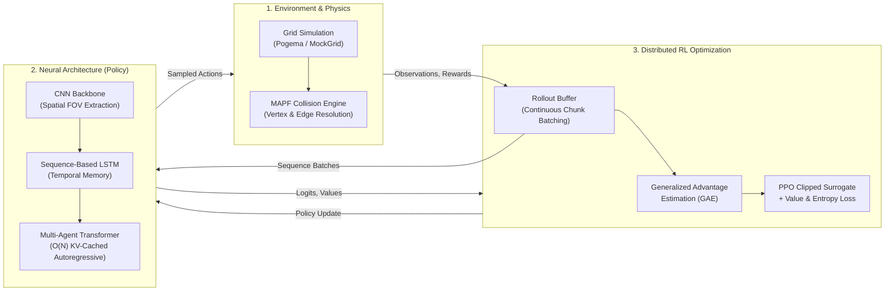

# SePar: Sequence Pathfinder for Multi-Agent Pickup and Delivery

[](https://www.python.org/)
[](https://pytorch.org/)
[]()
[](LICENSE)

---

## 📖 Executive Summary

**SePar (Sequence Pathfinder)** is a production-grade, Multi-Agent Reinforcement Learning (MARL) framework designed for Multi-Agent Pickup and Delivery (MAPD) and Multi-Agent Path Finding (MAPF) tasks. Based on the autoregressive Multi-Agent Transformer (MAT) architecture, this repository elevates academic prototyping into a highly optimized, numerically rigorous engineering pipeline. 

It features true **Sequence-Based Backpropagation Through Time (BPTT)** for recurrent memory, strict mathematical invariant testing, **O(N) Key-Value (KV) Caching** for autoregressive decoding, and a fully functional MAPF physics engine that strictly enforces vertex and edge collision invariants during multi-agent navigation.

---

## 🏗️ Architectural Overview



---

## ⚡ Key Engineering Features

- **$O(N)$ Autoregressive KV-Caching:** Overcame the native $O(N^3)$ computational bottleneck of Multi-Agent Transformers by implementing a custom exact incremental Key-Value (KV) cache. Cross-attention keys and values are computed strictly once, reducing sequential decoding latency to $O(N)$ without loss of mathematical precision.
- **Sequence-Based Recurrent PPO (BPTT):** Eradicated stale 1-step gradient truncations by engineering contiguous trajectory chunk batching. The LSTM hidden states are sequentially unrolled through time during the PPO update phase, enabling genuine Backpropagation Through Time (BPTT) for robust temporal memory.
- **Rigorous MAPF Collision Physics:** Implemented an iterative kinematic resolution engine that strictly blocks multi-agent collisions. Actively prevents both Vertex Collisions (multiple agents entering the same tile) and Edge Collisions (agents swapping tiles), enforcing real-world robotics traffic constraints.
- **Mathematical Invariant Testing Suite:** Moved beyond superficial shape-checking with a deep verification suite. Tests assert exact numerical invariants, ensuring PPO Importance Sampling ratios initialize strictly at $1.0$, GAE temporal boundaries mask correctly, and identical stochastic sequences remain aligned.
- **Production CLI & Safe Serialization:** Full `argparse` CLI integration for dynamic hyperparameter sweeping, coupled with strict `@dataclass` serialization to bypass PyTorch 2.6+ pickling security vulnerabilities during checkpointing.

---

## 📁 Repository Structure

```text
01_separ-multi-agent-pathfinding/
├── .github/workflows/ci.yml        # Continuous Integration test runner
├── .gitignore                      # Hardened Git exclusions (checkpoints, pycache, venv)
├── LICENSE                         # MIT License terms
├── README.md                       # Architectural overview & execution guide
├── requirements.txt                # Pinned production ML dependencies
├── train.py                        # Centralized parameterized CLI training launcher
├── src/                            # Modular package source
│   ├── __init__.py
│   ├── config.py                   # Type-safe @dataclass for unified hyperparameters
│   ├── environment.py              # MAPF collision physics & Pogema environment wrappers
│   ├── models.py                   # CNN, LSTM, and KV-Cached Multi-Agent Transformer
│   ├── trainer.py                  # PPO Rollout Buffer, GAE, and Sequence-Aligned Batches
│   └── evaluate.py                 # Empirical deterministic policy evaluation & latency metrics
├── tests/                          # Rigorous mathematical invariant test suite
│   ├── __init__.py
│   ├── test_env.py                 # MAPF collision and boundary invariant tests
│   ├── test_models.py              # KV-Cache equivalence and BPTT gradient validation
│   └── test_trainer.py             # PPO Ratio=1.0 and GAE masking invariant verification
└── checkpoints/                    # Directory for safely serialized policy checkpoints
```

---

## 🛠️ Quick Setup (Installation)

### Prerequisites
- **Operating System:** Linux (Ubuntu 20.04+ recommended) or Windows (WSL2 / Native)
- **Compute:** NVIDIA GPU (CUDA 11.8+) recommended, CPU supported for smaller grid testing.
- **Python:** Version 3.9 or higher

### Environment Setup

```bash
# 1. Clone the repository
git clone https://github.com/Taha-JN/01_separ-multi-agent-pathfinding.git
cd 01_separ-multi-agent-pathfinding

# 2. Initialize and activate Python virtual environment
python -m venv .venv
source .venv/bin/activate  # On Windows: .venv\Scripts\activate

# 3. Install dependencies
pip install --upgrade pip
pip install -r requirements.txt
```

---

## 🚀 Execution Workflow

### Step 1: Algorithmic Verification (Unit Tests)
Before initiating training, verify all mathematical, physical, and autograd invariants pass seamlessly on your local hardware:
```bash
python -m unittest discover -v tests
```
*Expected Output: `Ran tests in ~0.6s ... OK`*

### Step 2: Reinforcement Learning Pipeline (Training)
Launch the end-to-end PPO training pipeline using the parameterized CLI. The environment supports robust multi-agent map topologies:
```bash
# Basic run with defaults (Small Warehouse, 8 Agents, CPU/GPU Auto-detect)
python train.py

# Custom high-throughput cluster run (Large Warehouse, 16 Agents, 100 Iterations)
python train.py --env warehouse_large --agents 16 --iterations 100 --lr 3e-4 --device cuda:0
```
*Checkpoints are securely saved as dictionaries within `checkpoints/separ_policy.pt`.*

### Step 3: Inference & Evaluation
During training, the system automatically evaluates the deterministic policy across empirical rollouts, measuring absolute throughput (`targets/step`), episodic returns, and autoregressive millisecond latency.

---

## 🙏 Acknowledgments & Attribution

- **Original Inspiration:** Architecture conceptually grounded by the original SePar framework for Multi-Agent Path Finding via sequence modeling.
- **Pogema:** Grid-based multi-agent pathfinding environments ([pogema](https://github.com/TinkoffCreditSystems/pogema)).
- **PyTorch:** Underlying tensor computation and autograd engines.
